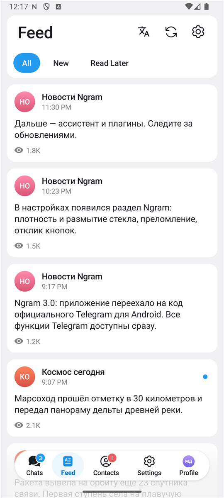
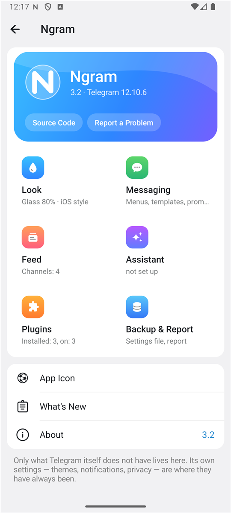

<div align="center">


# Ngram

**An unofficial Telegram client for Android: all of Telegram, plus an iOS-style look, a feed of your channels, an assistant that runs on your own AI key, and plugins.**

Built on the source code of Telegram for Android 12.10.6 · GPL-2.0

[Русский](README.md)

</div>

<p align="center">
  
  
  
  
</p>

## What it is

Ngram is Telegram for Android with things added that Telegram itself does not have:

- **An iOS-style chat screen.** The unread count next to the back arrow, a title capsule as wide as the chat's name, the attach and record buttons standing apart from the message field, glass that gives under the finger, coloured profile headers.
- **Feed.** The newest posts of all the channels you follow in one list on a tab of its own, with "read later" and an assistant digest. No recommendations: your channels only.
- **Liquid glass your way.** Sliders for density, blur, edge refraction and highlight, a colour tint, ready-made and saved sets, three kinds of button press.
- **Messaging tools.** A reminder set from a message, your own double-tap action, templates, chat export and breakdown, a list of unsent texts, a question before a sticker, a GIF or a call.
- **Assistant.** A panel of actions over a message, a chat or the feed. It works with your own API key — OpenAI, Claude, Gemini, OpenRouter, a local Ollama, or any OpenAI-compatible service. Requests go from the phone straight to the provider; Ngram has no servers.
- **Plugins.** Extensions in Python written with Ngram's own kit: commands, events, menu entries, settings, a store, timers, network. The file is read before it is installed and you are shown what its code can do. exteraGram-style plugins load too; replacing the app's methods (`hook_method`) is not supported.
- **Sixteen app icons**, from plain to meme.

There is no "ghost mode" and there will not be one: hiding read marks, typing or online status, and getting around copy protection in chats, are forbidden by Telegram's terms for third-party apps.

Everything else — chats, calls, stories, secret chats, folders, bots — is Telegram's own code, unchanged. Ngram does not duplicate Telegram's settings: its own corner (`Settings → Ngram`) holds only what Telegram lacks.

> [!IMPORTANT]
> Ngram is not affiliated with Telegram. Its own features were checked in an emulator on a made-up account. Signing in with a real account, the arm64 build on a real phone and the assistant with a real key were not checked by the author.

A plugin in Ngram's kit:

```python
# @id      hello
# @name    Hello, world
# @version 1.0

from ngram import plugin, ui

@plugin.command(".hello", help="send a greeting")
def hello(cmd):
    return "Hello, %s!" % (cmd.args or "world")

@plugin.on("chat.open")
def opened(event):
    ui.toast("Chat %d is open" % event.chat_id)
```

The documentation is in Russian: [look](docs/look.md), [feed](docs/feed.md), [messaging](docs/chats.md), [assistant](docs/assistant.md), [plugins](docs/plugins.md), [architecture](docs/architecture.md), [building](docs/building.md), [changes to Telegram's code](docs/changes.md).
## How it is put together

Telegram's code lives in `TMessagesProj` and is barely touched: about thirty files, every change marked with a `// Ngram:` comment. Everything of Ngram's own lives in the separate `Ngram_App` module and talks to Telegram's code through three small classes in `org.ngram.core` (`NgramHooks`, `NgramConfig`, `NgramMotion`). A new Telegram release can therefore be taken with a plain `git merge`.

## Building

You need JDK 17, Android SDK 36, NDK 27.2.12479018, CMake 3.22.1 and your own `api_id` / `api_hash` from https://my.telegram.org, put into `local.properties`:

```properties
sdk.dir=/path/to/Android/Sdk
telegram.apiId=123456
telegram.apiHash=0123456789abcdef0123456789abcdef
```

```bash
git clone --recursive --shallow-submodules https://github.com/Neizvestnyi22/Ngram.git Ngram

# the native library, once per architecture (about 20 minutes)
./gradlew :TMessagesProj:externalNativeBuildRelease -PbuildNative -Pabi=arm64-v8a
# strip it into TMessagesProj/jniLibs/arm64-v8a/ — see docs/building.md

# the app
./gradlew :Ngram_App:assembleRelease -Pabi=arm64-v8a
```

## Documentation

The detailed documentation is in Russian:

- [Architecture](docs/architecture.md) — the two modules, the hook points, how to add a setting or a screen
- [Building](docs/building.md)
- [Look settings](docs/look.md) — what each slider changes and where in the code
- [Chats](docs/chats.md) — message options, the message menu, templates, export
- [Plugins](docs/plugins.md) — installing, writing one, what is and is not compatible with exteraGram
- [Assistant](docs/assistant.md) — what is sent where, providers, key storage
- [Debug demo mode](docs/demo.md) — looking at screens without an account
- [Changes to Telegram's code](docs/changes.md)

## Licence

GNU GPL version 2, the same as the code it is built on. See [LICENSE](LICENSE).

[Telegram for Android](https://github.com/DrKLO/Telegram) is © Telegram; nearly all the code in this repository was written by its authors. The assistant's answers are rendered with [Markwon](https://github.com/noties/Markwon) (Apache-2.0).
