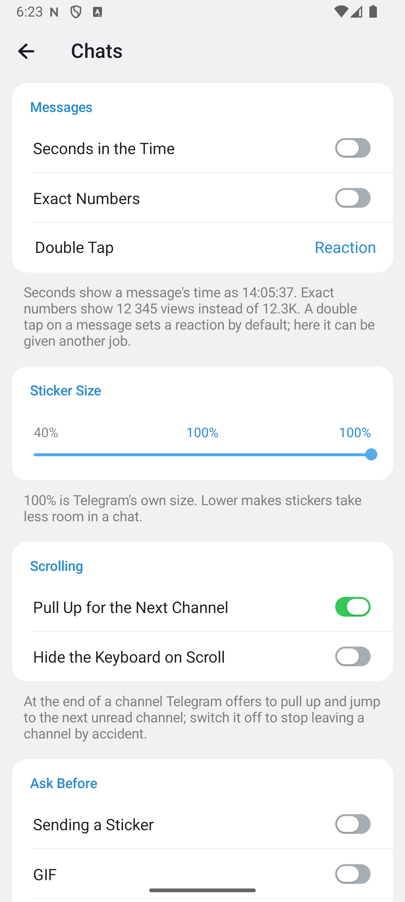
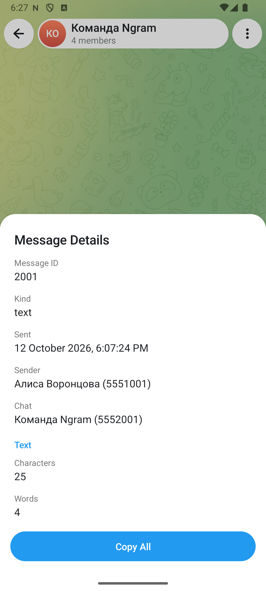
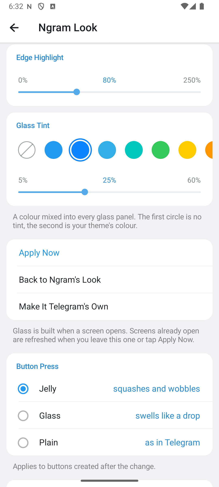
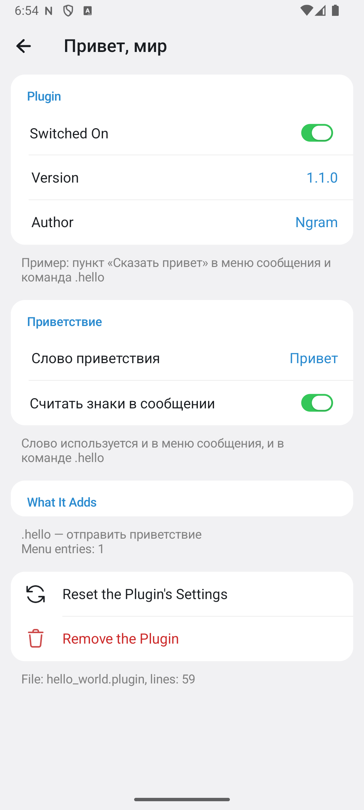
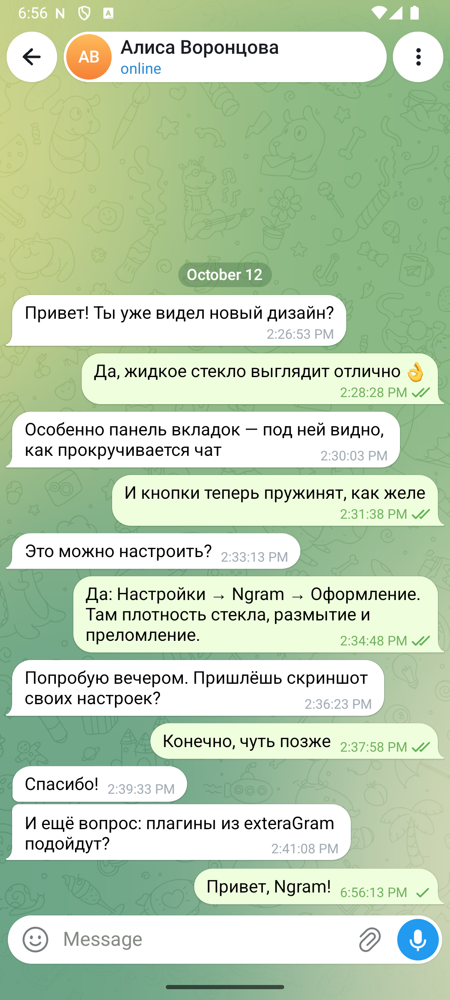
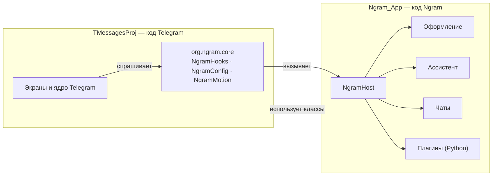

# Ngram

**Неофициальный клиент Telegram для Android: весь Telegram плюс настраиваемое жидкое стекло, инструменты для переписки, ассистент с вашим ключом ИИ и плагины.**

Основан на исходном коде Telegram для Android 12.10.6 · лицензия GPL-2.0

[English](README.en.md) · [Чаты](docs/chats.md) · [Плагины](docs/plugins.md) · [Как устроено](docs/architecture.md) · [Сборка](docs/building.md) · [Что изменено в Telegram](docs/changes.md)

  
  
  
  

## Что это

Ngram — это Telegram для Android, в который добавлено своё:

- **Оформление.** Ползунки для жидкого стекла (плотность, размытие, преломление, блик по краю), цветной оттенок стекла, готовые и свои наборы, три вида отклика кнопок, переключатели в стиле iOS, шесть значков приложения и настройки главного экрана.
- **Чаты.** Секунды во времени, точные числа, своё действие на двойное нажатие, размер стикеров, вопросы перед отправкой стикера, GIF и звонком, «сначала прослушать» для голосовых, шаблоны, экспорт и статистика переписки, подробности сообщения и профиля.
- **Ассистент.** Несколько разговоров с ИИ и действия над сообщениями: объяснить, перевести, пересказать, предложить ответ, разобрать картинку, расшифровать голосовое. Работает с вашим собственным ключом API — OpenAI, Claude, Gemini, OpenRouter, локальный Ollama и любой совместимый сервис.
- **Плагины.** Расширения на Python с именами SDK, как в exteraGram: команды, пункты меню, свои настройки.
- **Своё имя и значок.** Ngram не выдаёт себя за официальное приложение.

Чего в Ngram нет и не будет: «режима призрака» и других способов скрыть прочтение, набор текста или статус «в сети», а также обхода запрета на копирование в защищённых чатах. Это запрещено условиями Telegram для сторонних приложений.

Всё остальное — чаты, звонки, истории, секретные чаты, папки, боты — это код самого Telegram без переделок.

> [!IMPORTANT]
> Ngram не связан с Telegram и не является его официальным приложением. Версия 3.1 — ранняя: её собственные функции проверены в эмуляторе на выдуманном аккаунте, см. раздел [«Состояние»](#состояние).

## Возможности Ngram

### Оформление

`Настройки → Ngram → Оформление`

| Настройка | Что делает |
| --- | --- |
| Наборы стекла | Пять готовых наборов и свои: один набор задаёт все ползунки сразу. |
| Плотность стекла | Насколько стеклянные панели прозрачны. 100% — как в Telegram, Ngram начинает с 80%. |
| Размытие под прозрачным стеклом | Панель вкладок и круглые кнопки. 0% — чистая линза. |
| Размытие под матовым стеклом | Заголовки, поле ввода, панели. |
| Преломление по краю | Насколько край стекла искажает то, что под ним. Нужен Android 13+. |
| Блик по краю | Яркость светлой линии по контуру. |
| Оттенок стекла | Цвет, который подмешивается во все стеклянные панели, и его сила. |
| Отклик кнопок | «Желе» — кнопка сплющивается и дрожит; «Стекло» — набухает, как капля; «Обычный» — как в Telegram. |
| Переключатели как в iOS | Широкая зелёная капсула вместо тонкого переключателя. |
| Жирный шрифт системы | Заголовки рисуются шрифтом телефона, а не встроенным Roboto. |
| Подписи на панели вкладок | Без них на панели остаются одни значки. |
| Кнопка камеры для историй | Убирает круглую кнопку над «Новым сообщением». |
| Истории над списком чатов | Убирает ряд историй. |
| Заголовок | Свой текст над списком чатов вместо надписи Ngram. |
| Значок приложения | Шесть значков Ngram: Ngram, Белый, Мята, Закат, Золото, Графит (в настройках чатов Telegram). |

Подробно, с указанием мест в коде: [docs/look.md](docs/look.md).

  
  
  
  

### Чаты

`Настройки → Ngram → Чаты`

| Настройка | Что делает |
| --- | --- |
| Секунды во времени | Время сообщения как 14:05:37. |
| Точные числа | 12 345 просмотров вместо 12,3K. |
| Двойное нажатие | Реакция, ответ, изменить, скопировать, в Избранное, подробности или ничего. |
| Размер стикеров | От 40 до 100%. |
| Следующий канал потягиванием | Можно отключить, чтобы не уходить из канала случайно. |
| Прятать клавиатуру при прокрутке | |
| Спрашивать перед стикером, GIF, звонком | Защита от случайных нажатий. |
| Голосовое: сначала прослушать | Запись не уходит сразу, а остаётся в поле ввода. |
| Меню сообщения | «В Избранное», «Повторить», «Копировать фото», «Сохранить стикер как картинку», «Подробности». |
| Шаблоны | Готовые фразы с подстановками `{имя}`, `{дата}`, `{время}`. |
| Скрывать мой номер | Номер в настройках и профиле показывается точками. |
| Запретить снимки экрана | И спрятать приложение в списке недавних. |

В меню чата появляется пункт **Ngram**: ассистент, шаблоны, переход к началу чата, статистика и экспорт переписки в текст, веб-страницу или JSON. В меню профиля — **Сведения** (ID, дата-центр, отметки, ссылки).

Подробно: [docs/chats.md](docs/chats.md).

  
  
  
  

### Ассистент

`Настройки → Ngram → Ассистент`

- Провайдеры на выбор, ключ хранится на устройстве в зашифрованном виде (Android Keystore).
- Запрос уходит с телефона **прямо провайдеру** — ни Telegram, ни какие-либо серверы Ngram в этом не участвуют. Серверов у Ngram нет вовсе.
- В меню сообщения и в меню чата появляется пункт «Ассистент». Текст, картинка или запись отправляются провайдеру только после выбора действия, а в самый первый раз — только после вашего согласия.
- Картинки: что на фото, текст с фото, вопрос о фото. Голосовые и видеосообщения: расшифровка в текст.
- Несколько разговоров, которые хранятся на устройстве.
- В секретных чатах и чатах с запретом копирования ассистент не предлагается.
- Ответы оформляются: заголовки, списки, код, цитаты.

Подробно: [docs/assistant.md](docs/assistant.md).

  
  
  

### Плагины

`Настройки → Ngram → Плагины`

Плагин — файл `.plugin` с программой на Python. Он может добавлять команды (написали `.hello` — в чат ушло приветствие), пункты в меню сообщения, чата и профиля, собственную страницу настроек, следить за запросами и новыми сообщениями. Имена в SDK — как в exteraGram.

- Устанавливается из файла, из сообщения в чате или из трёх примеров, которые идут с приложением.
- Перед установкой показывается, что это за плагин, и спрашивается согласие; установленный плагин выключен, пока вы его не включите.
- Плагин, который ошибается раз за разом, выключается сам; после двух неудачных запусков подряд включается безопасный режим.

> [!WARNING]
> Плагин — чужая программа внутри приложения с доступом к вашему аккаунту в нём. Ставьте только то, чему доверяете.

Подмена методов приложения (`hook_method`) не поддерживается, поэтому часть плагинов exteraGram здесь не заработает. Подробно и с примером: [docs/plugins.md](docs/plugins.md).

  
  

### Данные

`Настройки → Ngram → Данные`

- **Копия настроек.** Все настройки Ngram в одном файле JSON; ключи API в него не попадают.
- **Диагностика.** Отчёт для сообщения об ошибке: версия, устройство, эффекты, настройки Ngram, последний сбой. Без сообщений, имён и ключей.

## Установка

Готовые сборки, когда они есть, лежат на странице [Releases](../../releases). Собрать приложение самому: [docs/building.md](docs/building.md).

Нужен Android 8.0 или новее.

## Как это устроено

Код Telegram лежит в модуле `TMessagesProj` и почти не тронут. Всё своё Ngram держит в отдельном модуле `Ngram_App`, а с кодом Telegram общается через три небольших класса.

- В коде Telegram изменено около тридцати файлов, и каждое изменение помечено комментарием `// Ngram:`. Полный список — в [docs/changes.md](docs/changes.md).
- Благодаря этому новую версию Telegram можно подтянуть обычным `git merge`.

Подробно: [docs/architecture.md](docs/architecture.md).

## Структура репозитория

| Папка | Что в ней |
| --- | --- |
| [`Ngram_App/`](Ngram_App) | Приложение Ngram: имя, значок, манифест и все собственные функции. |
| [`Ngram_App/.../messenger/ui`](Ngram_App/src/main/java/org/ngram/messenger/ui) | Экраны Ngram: оформление, чаты, ассистент, плагины, данные. |
| [`Ngram_App/.../messenger/features`](Ngram_App/src/main/java/org/ngram/messenger/features) | Инструменты для переписки: меню сообщения, шаблоны, экспорт, статистика, сведения, копия настроек, диагностика. |
| [`Ngram_App/.../messenger/ai`](Ngram_App/src/main/java/org/ngram/messenger/ai) | Ассистент: провайдеры, сетевой клиент, готовые задания, разговоры. |
| [`Ngram_App/.../messenger/plugins`](Ngram_App/src/main/java/org/ngram/messenger/plugins) | Движок плагинов. |
| [`Ngram_App/src/main/python`](Ngram_App/src/main/python) | SDK плагинов на Python. |
| [`TMessagesProj/.../org/ngram/core`](TMessagesProj/src/main/java/org/ngram/core) | Три класса, через которые код Telegram обращается к Ngram. |
| [`TMessagesProj/`](TMessagesProj) | Код Telegram для Android. |
| [`docs/`](docs) | Документация. |

## Состояние

Проверено в эмуляторе Android 16 на выдуманном аккаунте (отладочный [демо-режим](docs/demo.md)), на отладочной и на оптимизированной сборке:

- запуск, список чатов, настройки;
- оформление: действие ползунков стекла, наборы, выбор оттенка, подписи вкладок, кнопка камеры, окно выбора значка;
- чаты: секунды во времени, точные числа, двойное нажатие, пункты меню сообщения («В Избранное», «Подробности»), меню чата → Ngram (шаблоны с подстановками, статистика, экспорт в файл), «Сведения» в профиле, скрытие номера;
- ассистент на локальном макете провайдера: список моделей, ответ с потоковой выдачей, пункт в меню сообщения, согласие на отправку;
- плагины: запуск Python, установка примера, его страница настроек, пункт в меню сообщения, команда в чате;
- данные: копия настроек в файл, отчёт диагностики.

Написано, но не проверено — в демо-режиме этого не воспроизвести:

- вопросы перед стикером, GIF и звонком, «сначала прослушать» для голосовых;
- «Копировать фото», «Сохранить стикер как картинку», «Повторить»;
- разбор картинок и расшифровка голосовых ассистентом;
- загрузка настроек из файла.

Не проверено автором вовсе:

- вход и работа с настоящим аккаунтом;
- сборка для arm64 на телефоне;
- ассистент с настоящим ключом.

Чего пока нет:

- подмены методов приложения в плагинах (`hook_method`), поэтому часть плагинов exteraGram не заработает;
- картинок в самом разговоре с ассистентом;
- уведомлений через Google (нужен свой проект Firebase) и карт Google (нужен свой ключ);
- сборки для 32-битных телефонов.

История изменений: [CHANGELOG.md](CHANGELOG.md).

## Лицензия и благодарности

Ngram распространяется под [GNU GPL версии 2](LICENSE), как и код, на котором он основан.

- [Telegram для Android](https://github.com/DrKLO/Telegram) — © Telegram, GPL-2.0. Почти весь код в этом репозитории написан его авторами.
- [Markwon](https://github.com/noties/Markwon) — оформление ответов ассистента, Apache-2.0.

Изменения, внесённые в код Telegram, перечислены в [docs/changes.md](docs/changes.md).
