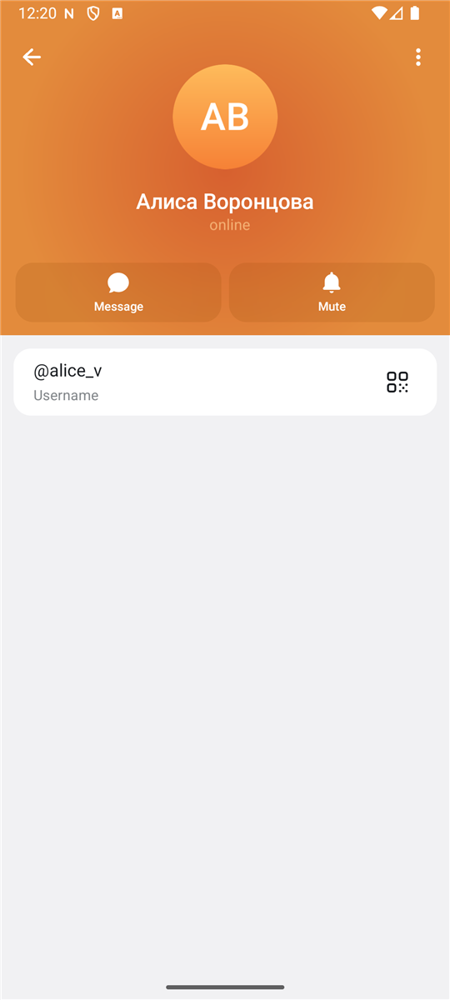
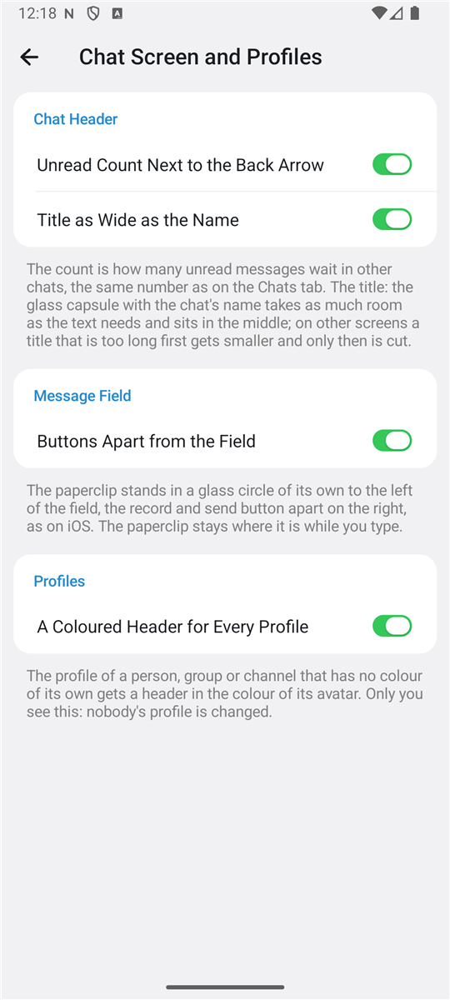
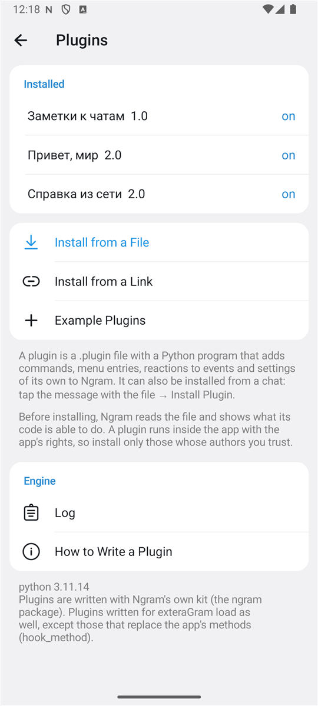
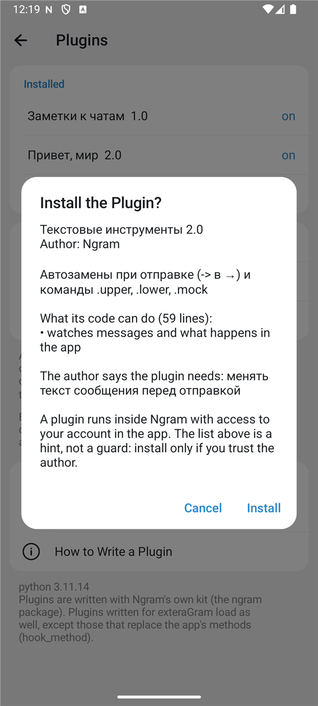
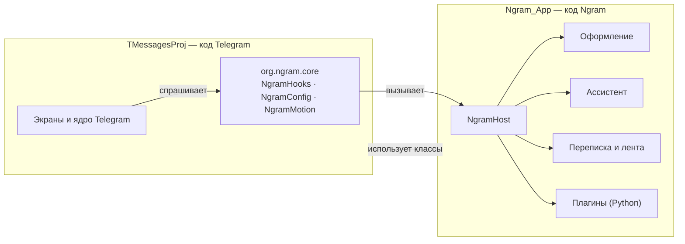

<div align="center">


# Ngram

**Неофициальный клиент Telegram для Android: весь Telegram плюс вид в духе iOS, лента каналов, ассистент с вашим ключом ИИ и плагины.**

Основан на исходном коде Telegram для Android 12.10.6 · лицензия GPL-2.0

[English](README.en.md) · [Оформление](docs/look.md) · [Лента](docs/feed.md) · [Переписка](docs/chats.md) · [Ассистент](docs/assistant.md) · [Плагины](docs/plugins.md) · [Как устроено](docs/architecture.md) · [Сборка](docs/building.md)

</div>

<p align="center">
  
  
  
  
</p>

## Что это

Ngram — это Telegram для Android, в который добавлено то, чего в самом Telegram нет:

- **Вид в духе iOS.** Число непрочитанных у стрелки «Назад», заголовок чата по длине названия, скрепка и кнопка записи отдельно от поля ввода, стекло, которое поддаётся под пальцем, цветные шапки профилей.
- **Лента.** Свежие посты всех ваших каналов одним списком на отдельной вкладке, с отложенным и пересказом от ассистента.
- **Жидкое стекло под себя.** Ползунки плотности, размытия, преломления и блика, цветной оттенок, наборы.
- **Переписка.** Напоминание о сообщении, своё действие на двойное нажатие, шаблоны, экспорт и разбор чата, список неотправленного, вопросы перед стикером и звонком.
- **Ассистент.** Работает с вашим собственным ключом API — OpenAI, Claude, Gemini, OpenRouter, локальный Ollama и любой совместимый сервис.
- **Плагины.** Расширения на Python на собственном наборе Ngram; плагины exteraGram тоже загружаются.
- **Шестнадцать значков приложения** — от строгих до мемных.

Чего в Ngram нет и не будет: «режима призрака» и других способов скрыть прочтение, набор текста или статус «в сети», а также обхода запрета на копирование в защищённых чатах. Это запрещено условиями Telegram для сторонних приложений.

Всё остальное — чаты, звонки, истории, секретные чаты, папки, боты — это код самого Telegram без переделок. Ngram не дублирует его настройки: в разделе Ngram только своё.

> [!IMPORTANT]
> Ngram не связан с Telegram и не является его официальным приложением. Его собственные функции проверены в эмуляторе на выдуманном аккаунте, см. раздел [«Состояние»](#состояние).

## Возможности Ngram

Все настройки Ngram — за одной строкой: `Настройки → Ngram`.

### Экран чата в духе iOS

`Настройки → Ngram → Оформление → Экран чата и профили`

| Что | Как выглядит |
| --- | --- |
| Счётчик у стрелки «Назад» | Рядом со стрелкой — сколько непрочитанных ждёт в других чатах. Капсула растягивается под число. |
| Заголовок по длине названия | Стеклянная капсула с именем занимает столько места, сколько нужно тексту, и стоит по центру. Длинные заголовки других экранов сначала уменьшаются, потом обрезаются. |
| Кнопки отдельно от поля | Скрепка в своём стеклянном круге слева, кнопка записи и отправки отдельно справа. |
| Живое стекло | Стекло под стрелкой, заголовком, меню и скрепкой поддаётся под пальцем вместе с кнопкой. |
| Цветные профили | Профиль без своего цвета получает шапку в цвет аватара. Видите это только вы. |

Каждое выключается отдельно. Подробно: [docs/look.md](docs/look.md).

<p align="center">
  
  
  
  
</p>

### Лента

Вкладка **Лента** на главном экране

- Свежие посты каналов, на которые вы подписаны, одним списком по времени. Без рекомендаций: только ваши каналы.
- Фильтры «Все», «Новые», «Отложенное». Пост можно отложить, переслать себе или убрать его канал из ленты.
- Пересказ ленты ассистентом: 5–9 пунктов по свежим постам.
- Настройки: какие каналы показывать, скрытие постов по словам, короткие посты, сплошной список.
- Честно перед каналами: показанный пост засчитывается как просмотр, отметки о прочтении не меняются.

Подробно: [docs/feed.md](docs/feed.md).

### Стекло и движение

`Настройки → Ngram → Оформление`

| Настройка | Что делает |
| --- | --- |
| Наборы стекла | Пять готовых наборов и свои: один набор задаёт все ползунки сразу. |
| Плотность, размытие, преломление, блик | Четыре свойства жидкого стекла Telegram, каждое своим ползунком. 100% — как в Telegram. |
| Оттенок стекла | Цвет, который подмешивается во все стеклянные панели. |
| Отклик кнопок | «Желе», «Стекло» или обычный, как в Telegram. Действует на кнопки, плитки, вкладки и стекло шапки. |
| Переключатели как в iOS | Широкая зелёная капсула. |
| Главный экран | Свой заголовок, панель вкладок без подписей, без ряда историй и кнопки камеры. |
| Значок приложения | Шестнадцать значков на одной странице: Ngram, Белый, Мята, Закат, Золото, Графит, Стекло, Терминал, 3310, Ретро 95, Синтвейв, brat, Deal With It, Нян, Stonks, Кот. |

<p align="center">
  
  
  
  
</p>

### Переписка

`Настройки → Ngram → Переписка`

| Настройка | Что делает |
| --- | --- |
| Напомнить | Пункт в меню сообщения: Telegram пришлёт сообщение в «Избранное» в выбранное время. |
| Двойное нажатие | Реакция, ответ, изменить, скопировать, в Избранное, подробности или ничего. |
| Секунды во времени, точные числа | 14:05:37 и 12 345 вместо 12,3K. |
| Размер стикеров | От 40 до 100%. |
| Спрашивать перед стикером, GIF, звонком | Защита от случайных нажатий. |
| Голосовое: сначала прослушать | Запись не уходит сразу, а остаётся в поле ввода. |
| Меню сообщения | «Повторить», «Копировать фото», «Сохранить стикер как картинку», «Подробности». |
| Шаблоны | Готовые фразы с подстановками `{имя}`, `{дата}`, `{время}`. |
| Прятать мой номер на экране, запрет снимков экрана | Для случаев, когда вы показываете экран. |

В меню чата — пункт **Ngram**: ассистент, шаблоны, переход к началу чата, разбор и экспорт переписки. В меню главного экрана — **Неотправленное**: все чаты с набранным и не отправленным текстом. В меню профиля — **Сведения**.

Подробно: [docs/chats.md](docs/chats.md).

<p align="center">
  
  
  
</p>

### Ассистент

`Настройки → Ngram → Ассистент`

- Провайдеры на выбор, ключ хранится на устройстве в зашифрованном виде (Android Keystore).
- Запрос уходит с телефона **прямо провайдеру** — ни Telegram, ни какие-либо серверы Ngram в этом не участвуют. Серверов у Ngram нет вовсе.
- **Панель ассистента** в меню сообщения и чата: цитата, действия плитками и строка для своего вопроса.
- Над сообщением: суть, объяснение, перевод, варианты ответа, разбор картинки, текст из голосового.
- Над чатом: пересказ, «о чём договорились», «что ждут от меня», «вопросы без ответа», правка своего текста.
- Над лентой: пересказ свежих постов.
- Текст, картинка или запись отправляются провайдеру только после выбора действия, а в самый первый раз — только после вашего согласия. В секретных чатах и чатах с запретом копирования ассистент не предлагается.

Подробно: [docs/assistant.md](docs/assistant.md).

<p align="center">
  
  
  
  
</p>

### Плагины

`Настройки → Ngram → Плагины`

Плагин — файл `.plugin` с программой на Python. У Ngram свой набор для плагинов:

```python
# @id      hello
# @name    Привет, мир
# @version 1.0

from ngram import plugin, ui

@plugin.command(".hello", help="отправить приветствие")
def hello(cmd):
    return "Привет, %s!" % (cmd.args or "мир")

@plugin.on("chat.open")
def opened(event):
    ui.toast("Открыт чат %d" % event.chat_id)
```

- **Что умеет плагин:** команды, события (отправка сообщения, новые сообщения, открытие чата, открытие ссылки, любые внутренние уведомления приложения), пункты в четырёх меню, страница настроек, хранилище, таймеры, сеть, прямой доступ к классам приложения.
- **Перед установкой** Ngram читает файл и показывает, что умеет его код: выходит в интернет, отправляет сообщения, следит за событиями.
- **Установка** из файла, по ссылке, из чата или из пяти примеров. Обновление по ссылке из паспорта плагина.
- **Страховка:** плагин, который ошибается раз за разом, выключается сам; после двух неудачных запусков подряд включается безопасный режим. На странице плагина видно, сколько времени приложения он занимает.
- **Плагины exteraGram** (класс `BasePlugin`) загружаются тем же движком. Подмена методов приложения (`hook_method`) не поддерживается.

> [!WARNING]
> Плагин — чужая программа внутри приложения с доступом к вашему аккаунту в нём. Ставьте только то, чему доверяете.

Подробно, со всеми событиями и примерами: [docs/plugins.md](docs/plugins.md).

<p align="center">
  
  
  
  
</p>

### Копия и отчёт

`Настройки → Ngram → Копия и отчёт`

- **Копия настроек.** Все настройки Ngram в одном файле JSON; ключи API в него не попадают.
- **Диагностика.** Отчёт для сообщения об ошибке: версия, устройство, эффекты, настройки Ngram, последний сбой. Без сообщений, имён и ключей.
## Установка

Готовые сборки, когда они есть, лежат на странице [Releases](../../releases). Собрать приложение самому: [docs/building.md](docs/building.md).

Нужен Android 8.0 или новее.

## Как это устроено

Код Telegram лежит в модуле `TMessagesProj` и почти не тронут. Всё своё Ngram держит в отдельном модуле `Ngram_App`, а с кодом Telegram общается через три небольших класса.



- В коде Telegram изменено около сорока файлов, и каждое изменение помечено комментарием `// Ngram:`. Полный список — в [docs/changes.md](docs/changes.md).
- Благодаря этому новую версию Telegram можно подтянуть обычным `git merge`.

Подробно: [docs/architecture.md](docs/architecture.md).

## Структура репозитория

| Папка | Что в ней |
| --- | --- |
| [`Ngram_App/`](Ngram_App) | Приложение Ngram: имя, значок, манифест и все собственные функции. |
| [`Ngram_App/.../messenger/ui`](Ngram_App/src/main/java/org/ngram/messenger/ui) | Экраны Ngram: настройки с плитками, оформление, лента, переписка, ассистент, плагины, копия и отчёт. |
| [`Ngram_App/.../messenger/features`](Ngram_App/src/main/java/org/ngram/messenger/features) | Лента каналов и инструменты для переписки: меню сообщения, напоминания, шаблоны, экспорт, разбор чата, сведения, копия настроек, диагностика. |
| [`Ngram_App/.../messenger/ai`](Ngram_App/src/main/java/org/ngram/messenger/ai) | Ассистент: провайдеры, сетевой клиент, готовые задания, разговоры. |
| [`Ngram_App/.../messenger/plugins`](Ngram_App/src/main/java/org/ngram/messenger/plugins) | Движок плагинов. |
| [`Ngram_App/src/main/python`](Ngram_App/src/main/python) | Набор Ngram для плагинов (пакет `ngram`), движок и SDK, совместимый с exteraGram. |
| [`TMessagesProj/.../org/ngram/core`](TMessagesProj/src/main/java/org/ngram/core) | Три класса, через которые код Telegram обращается к Ngram. |
| [`TMessagesProj/`](TMessagesProj) | Код Telegram для Android. |
| [`docs/`](docs) | Документация. |

## Состояние

Проверено в эмуляторе Android 16 на выдуманном аккаунте (отладочный [демо-режим](docs/demo.md)), на отладочной и на оптимизированной сборке:

- запуск, список чатов, настройки, вкладка «Лента»;
- экран чата: счётчик у стрелки «Назад», заголовок по длине названия, скрепка и кнопка записи отдельно от поля, отправка сообщения;
- лента: сбор постов четырёх каналов, фильтры, настройки, открытие из меню главного экрана;
- профиль с цветной шапкой, экран настроек Ngram, страницы оформления, шестнадцать значков;
- панель ассистента над сообщением и над чатом (сами ответы на локальном макете провайдера проверялись в версии 3.1, этот код с тех пор не менялся);
- плагины на наборе Ngram: установка с показом того, что умеет код, команда в чате, пункт в меню сообщения и чата, настройки, хранилище, события `chat.open`, `chat.close`, `app.resume`, `app.pause`, уведомление приложения `app:dialogsNeedReload`, запрос в сеть, пакет с pypi.org, вызов функции другого плагина;
- меню сообщения с «Напомнить» и окно выбора времени, список неотправленного;
- запись настроек в файл и отчёт диагностики проверялись в версии 3.1.

Замер: на эмуляторе холодный запуск оптимизированной сборки с профилем компиляции занял 2,04 с против 2,20 с без него (медиана шести запусков). На телефоне цифры будут другими.

Написано, но не проверено — в демо-режиме этого не воспроизвести:

- само напоминание (доставку сообщения в «Избранное» в назначенное время), «Переслать себе» из ленты;
- картинки и видео в ленте, засчитывание просмотров, подгрузка более старых постов у каналов с длинной историей;
- вопросы перед стикером, GIF и звонком, «сначала прослушать» для голосовых;
- «Копировать фото», «Сохранить стикер как картинку», «Повторить»;
- разбор картинок и расшифровка голосовых ассистентом, пересказ ленты;
- событие плагинов `link.open`, обновление плагина по ссылке;
- загрузка настроек из файла.

Не проверено автором вовсе:

- вход и работа с настоящим аккаунтом;
- сборка для arm64 на телефоне (в эмуляторе она запускается через трансляцию ARM);
- вид стекла в чате: эмулятор с ним не справляется, поэтому экран чата проверялся с выключенными эффектами;
- ассистент с настоящим ключом.

Чего пока нет:

- подмены методов приложения в плагинах (`hook_method`), поэтому часть плагинов exteraGram не заработает;
- картинок в самом разговоре с ассистентом;
- уведомлений через Google (нужен свой проект Firebase) и карт Google (нужен свой ключ);
- сборки для 32-битных телефонов.
История изменений: [CHANGELOG.md](CHANGELOG.md).

## Лицензия и благодарности

Ngram распространяется под [GNU GPL версии 2](LICENSE), как и код, на котором он основан.

- [Telegram для Android](https://github.com/DrKLO/Telegram) — © Telegram, GPL-2.0. Почти весь код в этом репозитории написан его авторами.
- [Markwon](https://github.com/noties/Markwon) — оформление ответов ассистента, Apache-2.0.

Изменения, внесённые в код Telegram, перечислены в [docs/changes.md](docs/changes.md).
