

# Ngram

**Неофициальный клиент Telegram для Android: весь Telegram плюс настраиваемое жидкое стекло и ассистент с вашим ключом ИИ.**

Основан на исходном коде Telegram для Android 12.10.6 · лицензия GPL-2.0

[English](README.en.md) · [Как устроено](docs/architecture.md) · [Сборка](docs/building.md) · [Что изменено в Telegram](docs/changes.md)

  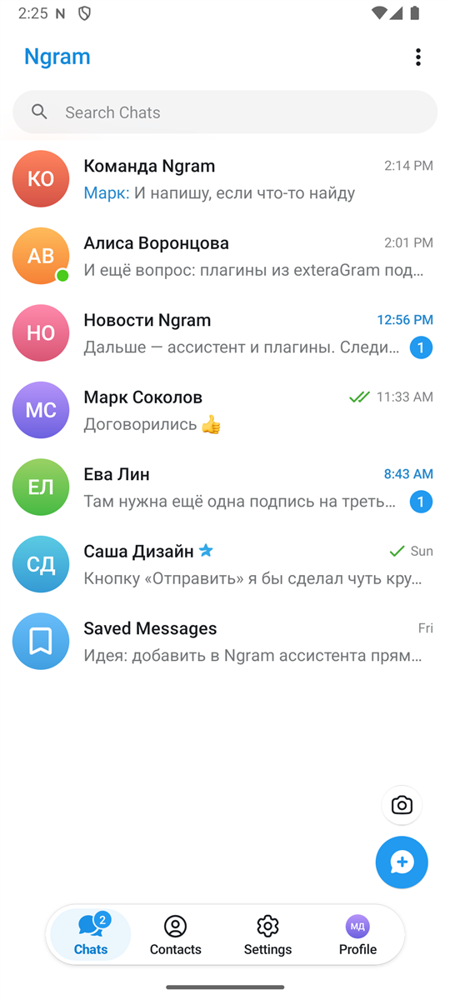
  
  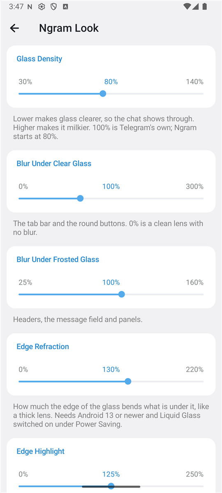
  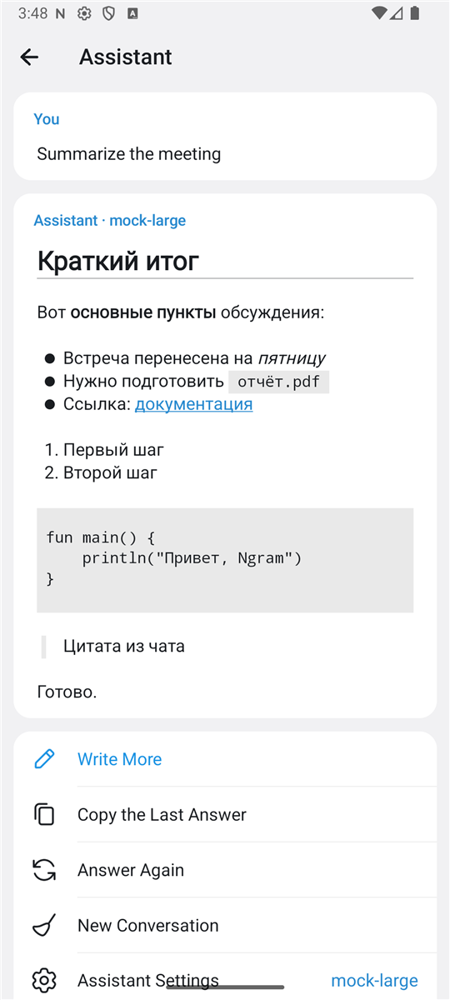

## Что это

Ngram — это Telegram для Android, в который добавлено своё:

- **Оформление.** Ползунки для жидкого стекла (плотность, размытие, преломление, блик по краю), три вида отклика кнопок, переключатели в стиле iOS и несколько настроек главного экрана.
- **Ассистент.** Чат с ИИ и действия над сообщениями: объяснить, перевести, пересказать, предложить ответ. Работает с вашим собственным ключом API — OpenAI, Claude, Gemini, OpenRouter, локальный Ollama и любой совместимый сервис.
- **Своё имя и значок.** Ngram не выдаёт себя за официальное приложение.

Всё остальное — чаты, звонки, истории, секретные чаты, папки, боты — это код самого Telegram без переделок.

> [!IMPORTANT]
> Ngram не связан с Telegram и не является его официальным приложением. Версия 3.0 — ранняя: её собственные функции проверены в эмуляторе на выдуманном аккаунте, см. раздел [«Состояние»](#состояние).

## Возможности Ngram

### Оформление

`Настройки → Ngram → Оформление`

| Настройка | Что делает |
| --- | --- |
| Плотность стекла | Насколько стеклянные панели прозрачны. 100% — как в Telegram, Ngram начинает с 80%. |
| Размытие под прозрачным стеклом | Панель вкладок и круглые кнопки. 0% — чистая линза. |
| Размытие под матовым стеклом | Заголовки, поле ввода, панели. |
| Преломление по краю | Насколько край стекла искажает то, что под ним. Нужен Android 13+. |
| Блик по краю | Яркость светлой линии по контуру. |
| Отклик кнопок | «Желе» — кнопка сплющивается и дрожит; «Стекло» — набухает, как капля; «Обычный» — как в Telegram. |
| Переключатели как в iOS | Широкая зелёная капсула вместо тонкого переключателя. |
| Жирный шрифт системы | Заголовки рисуются шрифтом телефона, а не встроенным Roboto. |
| Подписи на панели вкладок | Без них на панели остаются одни значки. |
| Кнопка камеры для историй | Убирает круглую кнопку над «Новым сообщением». |

Подробно, с указанием мест в коде: [docs/look.md](docs/look.md).

  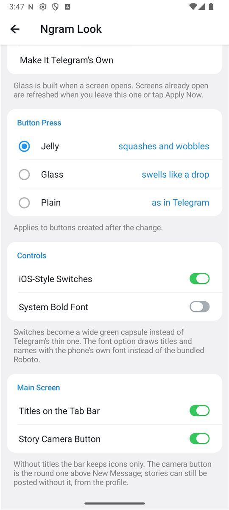
  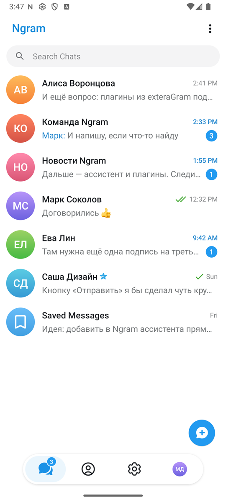
  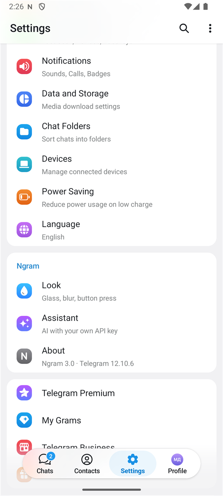
  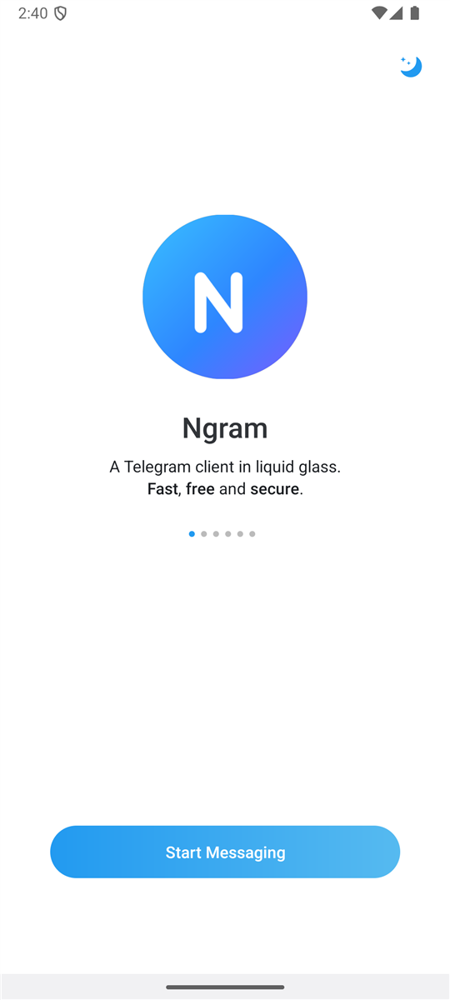

### Ассистент

`Настройки → Ngram → Ассистент`

- Провайдеры на выбор, ключ хранится на устройстве в зашифрованном виде (Android Keystore).
- Запрос уходит с телефона **прямо провайдеру** — ни Telegram, ни какие-либо серверы Ngram в этом не участвуют. Серверов у Ngram нет вовсе.
- В меню сообщения и в меню чата появляется пункт «Ассистент». Текст чата отправляется провайдеру только после выбора действия, а в самый первый раз — только после вашего согласия.
- Ответы оформляются: заголовки, списки, код, цитаты.

Подробно: [docs/assistant.md](docs/assistant.md).

  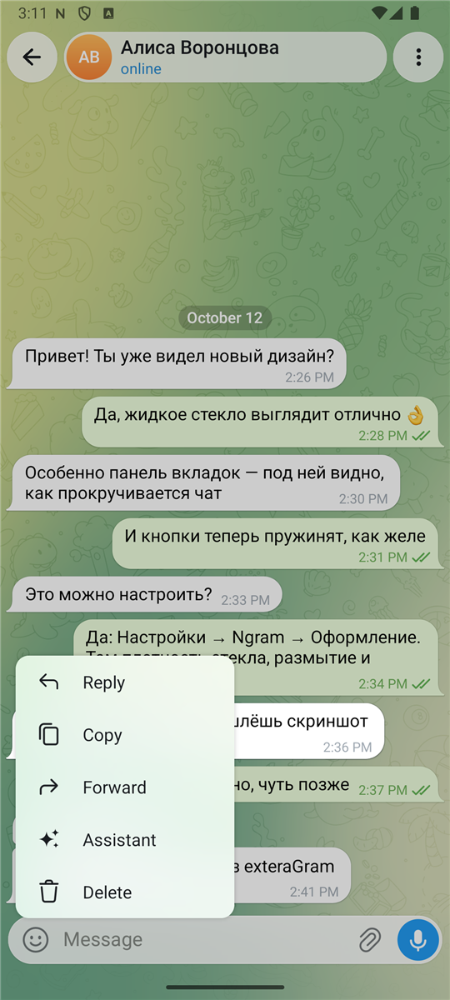
  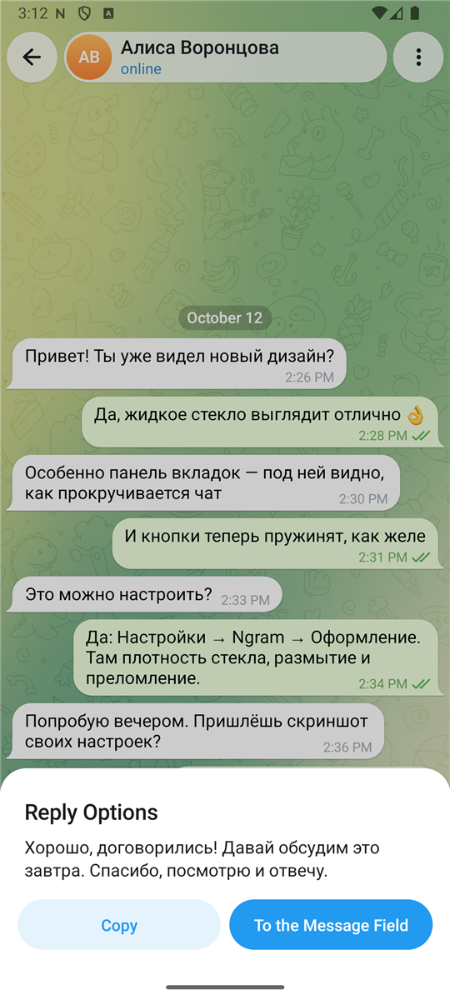
  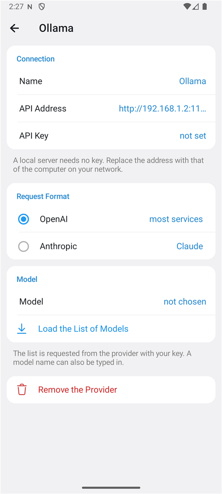

## Установка

Готовые сборки, когда они есть, лежат на странице [Releases](../../releases). Собрать приложение самому: [docs/building.md](docs/building.md).

Нужен Android 8.0 или новее.

## Как это устроено

Код Telegram лежит в модуле `TMessagesProj` и почти не тронут. Всё своё Ngram держит в отдельном модуле `Ngram_App`, а с кодом Telegram общается через три небольших класса.

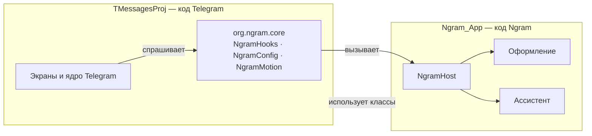

- В коде Telegram изменено около двадцати файлов, и каждое изменение помечено комментарием `// Ngram:`. Полный список — в [docs/changes.md](docs/changes.md).
- Благодаря этому новую версию Telegram можно подтянуть обычным `git merge`.

Подробно: [docs/architecture.md](docs/architecture.md).

## Структура репозитория

| Папка | Что в ней |
| --- | --- |
| [`Ngram_App/`](Ngram_App) | Приложение Ngram: имя, значок, манифест и все собственные функции. |
| [`Ngram_App/.../messenger/ui`](Ngram_App/src/main/java/org/ngram/messenger/ui) | Экраны Ngram: оформление, ассистент, «О приложении». |
| [`Ngram_App/.../messenger/ai`](Ngram_App/src/main/java/org/ngram/messenger/ai) | Ассистент: провайдеры, сетевой клиент, готовые задания. |
| [`TMessagesProj/.../org/ngram/core`](TMessagesProj/src/main/java/org/ngram/core) | Три класса, через которые код Telegram обращается к Ngram. |
| [`TMessagesProj/`](TMessagesProj) | Код Telegram для Android. |
| [`docs/`](docs) | Документация. |

## Состояние

Проверено в эмуляторе Android 16 на выдуманном аккаунте (отладочный [демо-режим](docs/demo.md)), на отладочной и на оптимизированной сборке:

- запуск, список чатов, настройки;
- экран оформления, действие ползунков стекла, отключение подписей вкладок и кнопки камеры;
- ассистент на локальном макете провайдера: список моделей, ответ с потоковой выдачей, пункт в меню сообщения, согласие на отправку.

Не проверено автором:

- вход и работа с настоящим аккаунтом;
- сборка для arm64 на телефоне;
- ассистент с настоящим ключом.

Чего пока нет:

- плагинов;
- в ассистенте — нескольких разговоров, картинок и распознавания речи;
- уведомлений через Google (нужен свой проект Firebase) и карт Google (нужен свой ключ);
- сборки для 32-битных телефонов.

История изменений: [CHANGELOG.md](CHANGELOG.md).

## Лицензия и благодарности

Ngram распространяется под [GNU GPL версии 2](LICENSE), как и код, на котором он основан.

- [Telegram для Android](https://github.com/DrKLO/Telegram) — © Telegram, GPL-2.0. Почти весь код в этом репозитории написан его авторами.
- [Markwon](https://github.com/noties/Markwon) — оформление ответов ассистента, Apache-2.0.

Изменения, внесённые в код Telegram, перечислены в [docs/changes.md](docs/changes.md).
