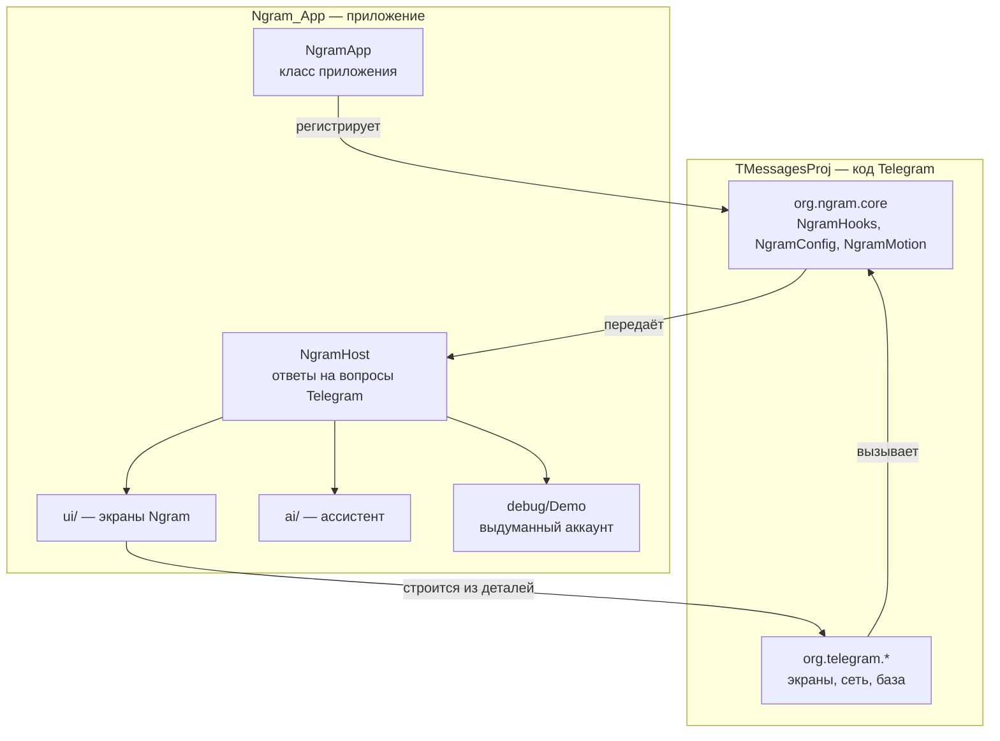

# Как устроен Ngram

Ngram — это код Telegram для Android, к которому сбоку приставлен отдельный модуль. Главное правило: **код Telegram меняется как можно меньше**, а всё своё живёт отдельно. Так новую версию Telegram можно подтянуть слиянием, не переписывая Ngram.

## Два модуля



| Модуль | Роль |
| --- | --- |
| `TMessagesProj` | Библиотека с кодом Telegram. Собирается как есть, с небольшими помеченными правками. |
| `Ngram_App` | Собственно приложение. Зависит от `TMessagesProj` и видит все его классы. |

Модуль `Ngram_App` видит код Telegram, а вот код Telegram про `Ngram_App` ничего не знает и знать не может: зависимость односторонняя. Поэтому между ними стоит посредник.

## Посредник: `org.ngram.core`

Три класса лежат внутри `TMessagesProj`, чтобы код Telegram мог к ним обращаться.

### `NgramHooks` — дверь к функциям Ngram

Интерфейс `NgramHooks.Host` перечисляет, о чём Telegram может спросить Ngram. Реализует его `NgramHost` из модуля приложения; регистрация происходит при старте, в `NgramApp.onCreate`:

```java
NgramHooks.install(new NgramHost());
```

Код Telegram вызывает статические методы `NgramHooks`. Если хоста нет, каждый из них ничего не делает, и Telegram работает как обычно. Любая ошибка в коде Ngram перехватывается здесь же и не роняет приложение.

| Метод | Откуда вызывается | Зачем |
| --- | --- | --- |
| `fillSettings`, `openSettings` | `SettingsActivity` | Раздел Ngram в настройках и переход на его экраны. |
| `onLaunch`, `onIntent` | `LaunchActivity` | Старт главного окна и новые намерения (отладочные входы). |
| `onRequest` | `ConnectionsManager` | Каждый запрос к Telegram перед отправкой: можно пропустить, заменить, отбросить или ответить на месте. |
| `onResponse` | `ConnectionsManager` | Ответ на запрос. |
| `onUpdates` | `MessagesController.processUpdates` | Обновления от Telegram до того, как приложение их применит. |
| `string` | `LocaleController` | Собственная формулировка для отдельных текстов (название приложения, первый экран). |
| `fillMessageMenu`, `onMessageMenu` | `ChatActivity` | Пункты Ngram в меню сообщения. |
| `chatMenuTitle`, `onChatMenu` | `ChatActivity` | Пункт Ngram в меню чата. |

Сейчас `onResponse` и `onUpdates` ничего не делают — это место для будущих плагинов.

### `NgramConfig` — настройки вида

Обычные статические поля (`glassTint`, `refraction`, `pressMotion`, `iosSwitch`…), которые код Telegram читает прямо во время рисования. Чтение поля ничего не стоит, поэтому их можно спрашивать хоть на каждом кадре. Хранятся в файле настроек `ngram3`; запись — через `NgramConfig.set(ключ, значение)`.

Здесь же два помощника для рисования: `tint(цвет)` — оттенок стеклянной панели с учётом настройки плотности, и `rim(цвет)` — блик по краю.

### `NgramMotion` — отклик кнопок

Заменяет анимацию нажатия Telegram на «желе» или «стекло». Подключён в двух местах: `ScaleStateListAnimator.apply` (обычные кнопки, больше двухсот мест в коде) и `ButtonBounce` (кнопки, нарисованные вручную).

## Как добавить свою настройку

Пример: переключатель, который что-то меняет в коде Telegram.

1. Поле и загрузка в `NgramConfig`:

   ```java
   public static boolean myOption = true;
   // в load():
   myOption = prefs.getBoolean("myOption", true);
   ```

2. Чтение в нужном месте кода Telegram, с пометкой:

   ```java
   // Ngram: описание того, что здесь меняется.
   if (NgramConfig.myOption) { ... }
   ```

3. Строка на экране оформления, `LookFragment`:

   ```java
   items.add(UItem.asCheck(MY_OPTION, tr("Моя настройка", "My Option")).setChecked(NgramConfig.myOption));
   // в onClick():
   case MY_OPTION:
       NgramConfig.set("myOption", !NgramConfig.myOption);
       changed = true;   // уже открытые экраны перестроятся при выходе
       refresh();
       break;
   ```

Перестроение открытых экранов (`rebuildFragments`) нужно потому, что многое в интерфейсе Telegram создаётся один раз при открытии экрана.

## Как добавить свой экран

Экраны Ngram собраны из тех же деталей, что и новые экраны настроек Telegram, — поэтому выглядят так же и сами подхватывают темы. Основа — `NgramFragment`:

```java
public class MyFragment extends NgramFragment {
    @Override protected CharSequence getTitle() { return tr("Мой экран", "My Screen"); }

    @Override protected void fillItems(ArrayList<UItem> items, UniversalAdapter adapter) {
        items.add(UItem.asHeader(tr("Раздел", "Section")));
        items.add(UItem.asButton(1, tr("Кнопка", "Button")));
        items.add(UItem.asShadow(tr("Пояснение под разделом.", "A note under the section.")));
    }

    @Override protected void onClick(UItem item, View view, int position, float x, float y) {
        if (item.id == 1) { /* ... */ }
    }
}
```

Чтобы экран открывался из настроек, добавьте строку в `NgramHost.fillSettings` и ветку в `NgramHost.openSettings`.

## Тексты на двух языках

Тексты Telegram приходят из его облачных языковых пакетов. Текстов Ngram там нет, поэтому они записаны прямо в коде парами:

```java
tr("Оформление", "Look")
```

`N.tr` выбирает вариант по языку, на котором сейчас показано приложение.

Если нужно заменить формулировку самого Telegram (как с названием приложения), одной правки `strings.xml` мало — облачный пакет её перекроет. Замена делается в `NgramHost.string()`.

## Замена картинок Telegram

Ресурс модуля приложения перекрывает одноимённый ресурс библиотеки. Так заменены значок, логотип в шапке (`telegram_logo_2`), логотип и буква на первом экране, значок уведомлений.

Тонкость: векторную картинку нужно класть в ту же папку, в какую сборка кладёт картинку Telegram, — `drawable-anydpi-v24`. Иначе победят растровые копии, которые сборка создаёт из вектора Telegram.

## Что особенного в сборке

- Ключи Telegram API читаются из `local.properties` и попадают в код через `BuildConfig`; в исходниках их нет.
- Нативная библиотека собирается один раз на архитектуру и лежит в `TMessagesProj/jniLibs`; обычная сборка CMake не запускает. Подробности — в [building.md](building.md).
- Сервисы, привязанные к официальному приложению (вход через Google, ключи доступа, покупки в Google Play, уведомления Firebase), отключены в `BuildVars` и в `NgramApp`.
