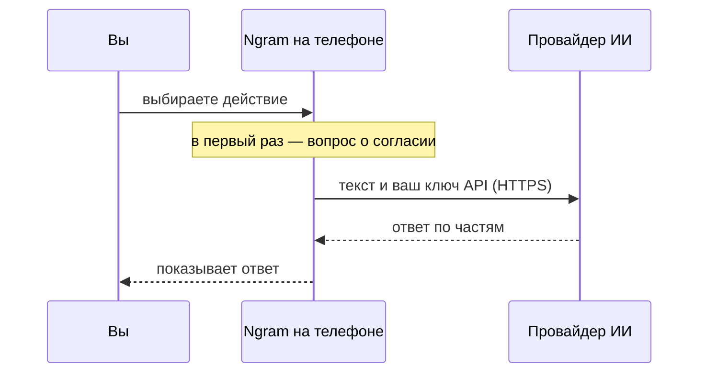
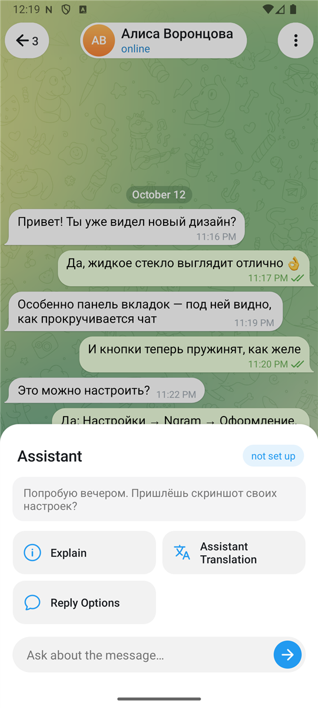

# Ассистент

Ассистент — это клиент к сервисам ИИ, встроенный в приложение. Своих серверов у Ngram нет: вы подключаете провайдера и свой ключ, а запросы идут с телефона прямо к нему.

## Что куда отправляется

- Текст чата уходит провайдеру **только после того, как вы выбрали действие**. Ничего не отправляется само, в фоне или «для улучшения».
- Перед самой первой отправкой Ngram спрашивает согласие и называет сервис, который увидит текст.
- Telegram в этом обмене не участвует и о нём не знает.
- Адрес без `https` принимается только для локальной сети (`localhost`, `10.x`, `192.168.x` и подобные) — чтобы ключ не ушёл по открытому каналу.

## Провайдеры

Готовые варианты: OpenAI, Anthropic Claude, Google Gemini, OpenRouter, Groq, DeepSeek, Mistral, xAI Grok, Together, а также локальные Ollama и LM Studio. Любой другой сервис с интерфейсом, совместимым с OpenAI, добавляется через пункт «Другой».

Поддерживаются два формата запросов:

| Формат | Адрес запроса | Кто так работает |
| --- | --- | --- |
| OpenAI | `<адрес>/chat/completions` | Почти все |
| Anthropic | `<адрес>/messages` | Claude |

Список моделей запрашивается у провайдера (`<адрес>/models`); название модели можно ввести и вручную.

## Где хранятся ключи

Ключ шифруется (AES-GCM) ключом из Android Keystore, который не покидает устройство, и только потом записывается в настройки приложения. Копии файла настроек недостаточно, чтобы его прочитать. На экране ключ показывается только последними четырьмя символами.

## Что умеет

**Разговор** (`Настройки → Ngram → Ассистент`): вопрос — ответ, с оформлением (заголовки, списки, код, цитаты). Можно ответить заново и скопировать ответ.

**Несколько разговоров.** «Новый разговор» начинает чистый лист, прежний остаётся в списке «Разговоры»: его можно открыть, переименовать (долгое нажатие) или удалить. Хранится до 40 разговоров, все — в одном файле на устройстве.

**Панель ассистента.** Пункт «Ассистент» в меню сообщения и в меню чата открывает панель: сверху цитата того, с чем работаем, и модель, которая будет отвечать (нажатие ведёт в настройки); ниже — действия плитками; внизу — строка для вопроса своими словами.

  

**В меню сообщения** панель предлагает:

| Плитка | Что делает |
| --- | --- |
| Суть | Короткий пересказ; появляется у длинных сообщений. |
| Объяснить | Смысл, сленг, сокращения, термины. |
| Перевод ассистентом | Перевод на язык приложения вашей моделью. Название отличается от «Перевести» Telegram нарочно: это другой перевод. |
| Варианты ответа | Три варианта; выбранный попадает в поле ввода. |
| Что на картинке, Текст с картинки | Для фото; нужна модель, которая понимает изображения. |
| Текст из записи | Для голосовых и видеосообщений. |
| Строка «Спросить о сообщении…» | Свой вопрос о тексте или о картинке. |

**Распознавание речи** идёт через вызов `audio/transcriptions` — он есть у OpenAI, Groq и совместимых сервисов; у Claude его нет. Модель для речи задаётся на странице провайдера (по умолчанию `whisper-1`, у Groq — `whisper-large-v3`). Фото перед отправкой уменьшается до 1568 точек по длинной стороне.

**Защищённые чаты.** В секретных чатах и в чатах, где владелец запретил копирование, ассистент не предлагается: то, что нельзя вынести из Telegram, не отправляется и стороннему сервису.

**В меню чата** (три точки в шапке) — пункт «Ngram» → «Ассистент»:

| Плитка | Что делает |
| --- | --- |
| Пересказ чата | Темы, решения, открытые вопросы. |
| О чём договорились | Только договорённости: кто, что и к какому сроку. |
| Что ждут от меня | Просьбы и вопросы, которые ждут вашего ответа, срочные — первыми. |
| Вопросы без ответа | Что спросили и на что не ответили. |
| Мой текст в поле ввода | Если в поле есть ваш текст: улучшить, исправить ошибки, сократить, расширить, сделать дружелюбнее или официальнее, перевести. |
| Строка «Спросить о чате…» | Свой вопрос о переписке. |

**В ленте** — значок перевода: пересказ свежих постов ваших каналов. См. [feed.md](feed.md).

В пересказ попадают последние загруженные сообщения чата; их число задаётся в настройках ассистента (от 30 до 400).

Пункт в меню сообщения отключается настройкой «Действия ассистента в меню»; в меню чата ассистент находится внутри пункта «Ngram».

## Настройки

| Настройка | Смысл |
| --- | --- |
| Постоянные инструкции | Текст, который добавляется к каждому запросу. |
| Температура | Свобода ответов. «Авто» оставляет значение провайдера — некоторые модели другого не принимают. |
| Сколько сообщений пересказывать | Больше сообщений — дороже запрос. |

## Код

| Файл | Что в нём |
| --- | --- |
| `ai/Ai.java` | Провайдеры, настройки, шифрование ключей. |
| `ai/AiClient.java` | Сетевой клиент: оба формата, потоковая выдача, понятные сообщения об ошибках. |
| `ai/AiTasks.java` | Тексты заданий и запуск задания в фоне. |
| `ai/AiTalk.java` | Разговоры и их хранение. |
| `ui/ai/AiInChat.java` | Что предлагать для сообщения и чата, проверка согласия. |
| `ui/ai/AiPanel.java` | Панель с плитками и строкой вопроса. |
| `ui/ai/AiSheet.java` | Окно с ответом поверх чата. |
| `ui/ai/AiChatFragment.java`, `AiTalksFragment.java`, `AiSettingsFragment.java`, `AiProviderFragment.java` | Экраны. |

## Чего пока нет

- поля ввода внизу экрана разговора — вопрос вводится в окне;
- картинок в самом разговоре с ассистентом (картинку можно разобрать из меню сообщения с фото).
