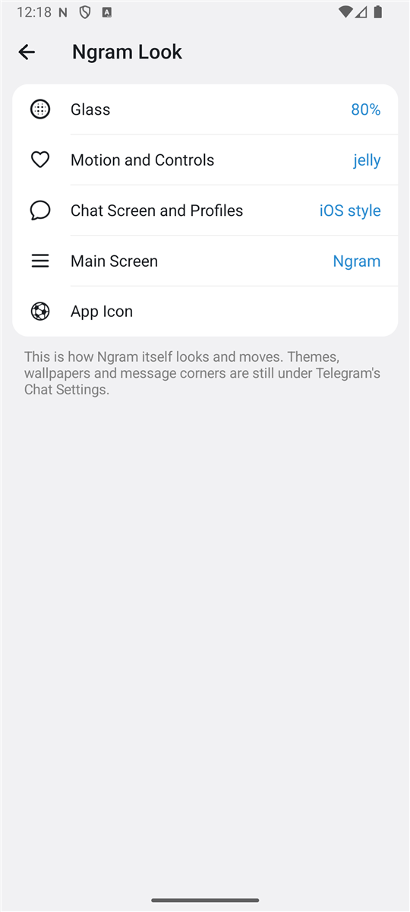
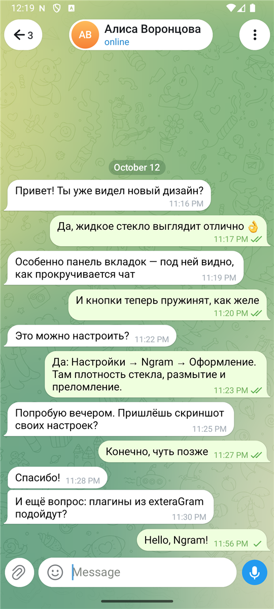
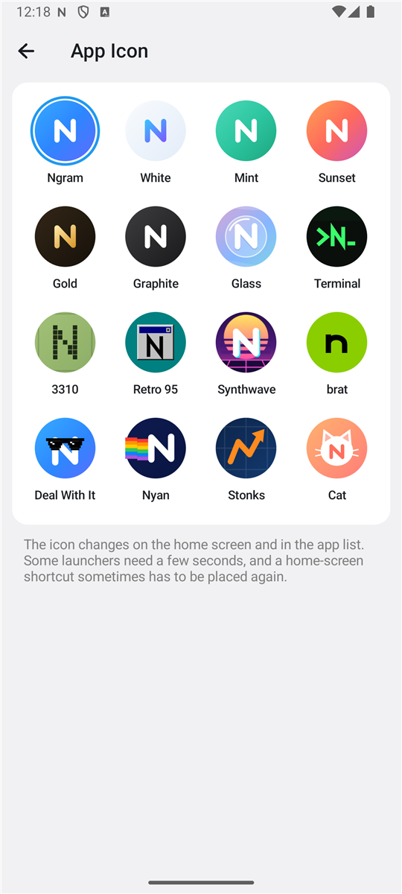

# Оформление

Экран `Настройки → Ngram → Оформление` — это `LookFragment`. Значения хранит `NgramConfig`, а читает их код рисования Telegram.

  
  

Оформление разбито на страницы:

| Страница | Что на ней |
| --- | --- |
| [Стекло](#стекло) | Наборы, ползунки, оттенок. |
| [Движение и элементы](#отклик-кнопок) | Отклик кнопок, переключатели, шрифт. |
| [Экран чата и профили](#экран-чата-и-профили) | Счётчик у стрелки «Назад», заголовок по длине, кнопки отдельно от поля, цветные профили. |
| [Главный экран](#главный-экран) | Заголовок, подписи вкладок, истории. |
| [Значок приложения](#значок-приложения) | Шестнадцать значков. |

Темы, обои и скругление сообщений — по-прежнему в настройках чатов Telegram: Ngram их не дублирует.

## Экран чата и профили

Всё включено по умолчанию и выключается по отдельности.

| Настройка | Поле | Что делает | Где в коде |
| --- | --- | --- | --- |
| Число непрочитанных у стрелки «Назад» | `backCounter` | Рядом со стрелкой — сколько непрочитанных сообщений ждёт в других чатах: то же число, что на вкладке «Чаты». Стеклянная капсула растягивается под число, цифры перелистываются. | `ActionBar.setNgramBackCount`, `NgramBackCounter` |
| Заголовок по длине названия | `fitTitle` | Капсула с названием чата занимает столько места, сколько нужно тексту, и стоит по центру. На остальных экранах слишком длинный заголовок сначала уменьшается (до 15sp) и только потом обрезается. | `ActionBar.dispatchDraw`, `ActionBar.ngramFitTitle` |
| Кнопки отдельно от поля | `iosInput` | Скрепка — в собственном стеклянном круге слева от поля, кнопка записи и отправки — отдельно справа. Скрепка остаётся на месте, пока вы печатаете. | `ChatActivityEnterView.setNgramSides`, `ChatInputViewsContainer` |
| Цветная шапка у каждого профиля | `colorProfiles` | Профиль без своего цвета получает шапку в цвет аватара. Видите это только вы. | `ProfileActivity`, `NgramConfig.profileColor` |

Стекло под стрелкой «Назад», заголовком, меню и скрепкой **поддаётся под пальцем** вместе с самой кнопкой — тем же движением, что выбрано в «Отклике кнопок».

Заголовок по длине использует механизм самого Telegram: он уже умеет так для закреплённых сообщений и комментариев, Ngram включает его для всех чатов.

## Стекло

В Telegram для Android стеклянные панели рисует набор классов в `ui/Components/blur3`. У каждой панели есть оттенок, размытие того, что под ней, преломление по краю и светлая кромка. Ngram не рисует стекло сам — он подкручивает эти четыре величины в местах, где Telegram их задаёт.

| Ползунок | Поле | Диапазон | Где применяется |
| --- | --- | --- | --- |
| Плотность стекла | `glassTint` | 30–140% | `BlurredBackgroundDrawable.updateColors` — прозрачность оттенка панели умножается на значение. |
| Размытие под прозрачным стеклом | `glassBlur` | 0–300% | `DownscaleScrollableNoiseSuppressor` — радиус слабого размытия (у Telegram 6dp). |
| Размытие под матовым стеклом | `frostBlur` | 25–160% | Там же — радиус сильного размытия (у Telegram 40dp). |
| Преломление по краю | `refraction` | 0–220% | `BlurredBackgroundDrawableRenderNode` — сила линзы в шейдере жидкого стекла. |
| Блик по краю | `rim` | 0–250% | `BlurredBackgroundDrawable.updateColors` — прозрачность светлой кромки. |

100% везде — в точности вид Telegram. Ngram начинает с более прозрачного стекла: плотность 80%, преломление 130%, блик 125%. Кнопки внизу экрана возвращают либо эти значения, либо значения Telegram.

Что стоит знать:

- **Стекло собирается при открытии экрана.** Поэтому изменения применяются к экранам, открытым после них. Уже открытые перестраиваются, когда вы выходите из настроек оформления или нажимаете «Применить сейчас».
- **Преломление работает на Android 13 и новее** и только если в `Настройки → Энергосбережение` включено «Жидкое стекло».
- **На слабых устройствах Telegram стекло не рисует вовсе** — панели непрозрачные, и ползунки ничего не меняют. Непрозрачный оттенок Ngram не трогает намеренно: полностью залитая панель у Telegram означает «стекло выключено».

### Оттенок

Поля `glassColor` и `glassColorStrength`. Выбранный цвет подмешивается в оттенок каждой стеклянной панели (5–60%) там же, в `NgramConfig.tint`. Первый кружок — без оттенка, второй — цвет вашей темы.

### Наборы

Набор задаёт сразу все ползунки и оттенок. С приложением идут пять: Ngram, Telegram, «Чистая линза», «Матовое», «Лёгкое». Текущее стекло можно сохранить как свой набор (до 12); свой набор удаляется долгим нажатием. Код — `features/LookPresets.java`.

## Отклик кнопок

Поле `pressMotion`, реализация — `NgramMotion`.

| Вариант | Что происходит |
| --- | --- |
| Желе | Под пальцем кнопка становится шире и ниже, а при отпускании несколько раз качается вокруг исходной формы. |
| Стекло | Кнопка слегка увеличивается, как капля, и мягко возвращается. |
| Обычный | Анимация Telegram: кнопка чуть сжимается. |

Движение ограничено в пикселях, а не в процентах: широкая карточка сдвигается на те же несколько пикселей, что и маленькая круглая кнопка, и не налезает на соседей.

Так же ведут себя плитки в настройках Ngram, вкладки ленты и стекло под кнопками в шапке чата и у строки ввода. Выбранная вкладка главного экрана при переключении слегка «выпрыгивает» и возвращается.

Действует на то, что создано после изменения.

## Элементы

- **Переключатели как в iOS** (`iosSwitch`) — `Switch.drawCapsule`. Рисуется только простой случай; переключатели с замком или с цветной волной остаются телеграмовскими.
- **Жирный шрифт системы** — это настройка самого Telegram (`SharedConfig.useSystemBoldFont`), которой в его интерфейсе нет.

## Главный экран

- **Подписи на панели вкладок** (`tabTitles`) — `GlassTabView`. Без подписей значки становятся чуть крупнее и встают по центру.
- **Кнопка камеры для историй** (`storyButton`) — `DialogsActivity.updateFloatingButtonVisibility`. Публиковать истории по-прежнему можно из профиля.

Ещё на главном экране:

| Настройка | Поле | Что делает |
| --- | --- | --- |
| Заголовок | `mainTitle` | Свой текст над списком чатов вместо надписи Ngram. Пустое значение возвращает надпись. |
| Истории над списком чатов | `stories` | Убирает ряд историй; список чатов начинается сразу под заголовком. Истории по-прежнему открываются из профилей. |

## Значок приложения

`Настройки → Ngram → Значок приложения`

  

Шестнадцать значков на одной странице, по четыре в ряд.

| Значки | Что это |
| --- | --- |
| Ngram, Белый, Мята, Закат, Золото, Графит | Буква N на разных фонах. |
| Стекло | Прозрачная линза — тема самого приложения. |
| Терминал | `>N_` зелёным по чёрному. |
| 3310 | N из квадратных точек экрана кнопочного телефона. |
| Ретро 95 | Серое окно с синим заголовком. |
| Синтвейв | Полосатое солнце над неоновой сеткой. |
| brat | Строчная буква на кислотно-зелёном. |
| Deal With It | N в пиксельных очках. |
| Нян | N летит по ночному небу, за ней радуга. |
| Stonks | Линия, которая только растёт, в форме N. |
| Кот | Главное животное интернета с N вместо мордочки. |

Первые шесть занимают места шести значков Telegram, остальные десять добавлены Ngram (`LauncherIconController`, псевдонимы в манифесте `Ngram_App`). Все рисунки — собственные, векторные; ограничения «только для Premium» на них нет. Тот же набор виден и в настройках чатов Telegram.
